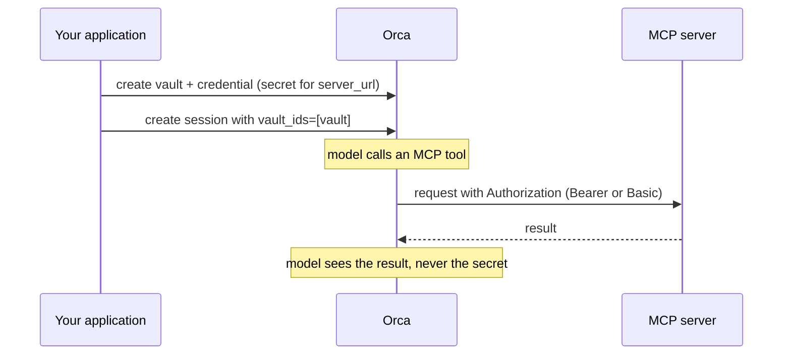

Your agent may need to log in to the services it uses, for example an MCP server that requires a bearer token, or a login and password. You should never put such a secret in instructions, messages, or files: anything the model can read, it can repeat. Vaults solve this.

A **vault** is a container for **credentials**. Each credential is a secret for one exact MCP server URL: a token, or a login and password. When you attach a vault to a session, Orca adds the matching secret to requests it sends to that server. The model never sees it, and the API never returns it once stored.

Creating, rotating, and deleting vaults and credentials needs the [admin role](/organizations#roles). Any member can attach a vault to a session.

<Note>
Hosted Orca reaches only the remote MCP servers on its allowed list, `https://docs.orcapods.ai` and `https://mcp.dataforseo.com`, so a credential for any other server is not used yet. See [MCP tools](/guides/mcp#allowed-servers). To ask for another server, post in **#help** on [Orca's Discord](https://discord.gg/btTYzdzvqq).
</Note>

## Three kinds of keys

New users often mix these up. They are separate and not interchangeable:

| Key | What it unlocks | Where it goes |
| --- | --- | --- |
| **Orca API key** | Your account on the Orca endpoint | Your application's client configuration |
| **Provider key** | A model provider account (OpenAI, Anthropic, ...) for your agents' models | Orca's provider settings; see [models and provider keys](/providers) |
| **Vault credential** | One MCP server | A vault attached to the session |

## How it works



## Create, use, rotate, and delete

Examples on this page assume `client` is an `OpenAI` client configured as in [Build with the API](/build-with-the-api).

```python
import os

vaults = client.beta.agents.vaults
url = "https://mcp.example.com/orders/mcp"

# 1. Create a vault and store the MCP server's token in it.
vault = vaults.create(name="orders")
credential = vaults.credentials.create(
    vault.id,
    name="read-orders",
    auth={
        "type": "static_bearer",
        "mcp_server_url": url,
        "token": os.environ["ORDERS_MCP_TOKEN"],
    },
)

# 2. Attach it when you create a session:
#    client.beta.agents.sessions.create(..., vault_ids=[vault.id])

# 3. Rotate the token later. You never need to read the old one.
vaults.credentials.update(
    credential.id,
    vault_id=vault.id,
    auth={"type": "static_bearer", "token": os.environ["NEW_ORDERS_MCP_TOKEN"]},
)

# 4. Delete them once no session needs them.
vaults.credentials.delete(credential.id, vault_id=vault.id)
vaults.delete(vault.id)
```

- **`mcp_server_url`** must be HTTPS and must match the MCP tool's `server_url` exactly.
- **Attach** the vault with `vault_ids=[vault.id]` when you create the session. Attach only the vaults that session needs.
- **Rotate** by sending a new token with `credentials.update`. You never need to read the old one, and you cannot.
- **Responses never include the token.** Keep your own copy in your secret manager if you need it again.

## Credential types

| `auth.type` | Use it when |
| --- | --- |
| `static_bearer` | The server accepts a fixed token. Orca sends it as a bearer token. |
| `mcp_oauth` | The server uses OAuth. You provide an `access_token`, its `expires_at`, and optionally `refresh` details (refresh token and token endpoint), and Orca refreshes the access token when it expires. |
| `static_basic` | The server takes a login and password (HTTP Basic). Orca sends them as `Authorization: Basic`. Created and rotated through Orca's own route, [below](#a-login-and-password). |

## A login and password

A `static_basic` credential holds a login and a password for one MCP server URL. DataForSEO's server is one: it takes your DataForSEO API login and API password (from app.dataforseo.com, under API access; not the password you sign in to their dashboard with). Orca sends them as `Authorization: Basic` with every request to that server. The login cannot contain a colon.

The OpenAI SDK's `credentials.create` knows only `static_bearer` and `mcp_oauth`, so you add a login and password through Orca's own route, `POST /api/vaults/{vault_id}/credentials`, which the CLI and the dashboard also use. It is an Orca extension, outside `/v1`, at the same host. The credential lands in the same vault as any other, and a session attaches it the same way, with `vault_ids`.

<Tabs>
<Tab title="CLI">
```bash
orca vaults create dataforseo
orca vaults credentials add dataforseo --name dataforseo --server https://mcp.dataforseo.com/mcp --basic --login YOUR_API_LOGIN
```

The CLI asks for the password at a hidden prompt. There is no password flag, so it never lands in your shell history. In a script, pipe it on stdin from an environment variable:

```bash
printenv DATAFORSEO_PASSWORD | orca vaults credentials add dataforseo --name dataforseo --server https://mcp.dataforseo.com/mcp --basic --login YOUR_API_LOGIN
```
</Tab>
<Tab title="Dashboard">
1. Open **Vaults** and the vault, then choose **Add credential**.
2. Under **Type**, choose **Login and password**.
3. Fill in **Name**, **MCP server URL**, **Login**, and **Password**, then choose **Add credential**.
</Tab>
<Tab title="Python">
```python
import json
import os
import urllib.request

# Orca's own routes sit beside /v1 on the same host.
origin = os.environ["ORCA_BASE_URL"].removesuffix("/v1")


def orca_api(path, body):
    request = urllib.request.Request(
        f"{origin}/api{path}",
        data=json.dumps(body).encode(),
        method="POST",
        headers={
            "Authorization": f"Bearer {os.environ['ORCA_API_KEY']}",
            "Content-Type": "application/json",
        },
    )
    with urllib.request.urlopen(request) as response:
        return json.load(response)


vault = client.beta.agents.vaults.create(name="dataforseo")
credential = orca_api(
    f"/vaults/{vault.id}/credentials",
    {
        "name": "dataforseo",
        "auth": {
            "type": "static_basic",
            "mcp_server_url": "https://mcp.dataforseo.com/mcp",
            "login": os.environ["DATAFORSEO_LOGIN"],
            "password": os.environ["DATAFORSEO_PASSWORD"],
        },
    },
)
# credential["auth"] is {"type": "static_basic", "mcp_server_url": ...}
```
</Tab>
<Tab title="TypeScript">
```typescript
// Orca's own routes sit beside /v1 on the same host.
const origin = process.env.ORCA_BASE_URL!.replace(/\/v1$/, '');
const headers = {
  Authorization: `Bearer ${process.env.ORCA_API_KEY}`,
  'Content-Type': 'application/json',
};

const vault = await client.beta.agents.vaults.create({ name: 'dataforseo' });
const response = await fetch(`${origin}/api/vaults/${vault.id}/credentials`, {
  method: 'POST',
  headers,
  body: JSON.stringify({
    name: 'dataforseo',
    auth: {
      type: 'static_basic',
      mcp_server_url: 'https://mcp.dataforseo.com/mcp',
      login: process.env.DATAFORSEO_LOGIN,
      password: process.env.DATAFORSEO_PASSWORD,
    },
  }),
});
if (!response.ok) throw new Error(`${response.status} ${await response.text()}`);
const credential = await response.json(); // auth is { type: 'static_basic', mcp_server_url }
```
</Tab>
</Tabs>

The answer is the credential as `/v1` shows it: `id`, `name`, `vault_id`, timestamps, and `auth` with only `type` and `mcp_server_url`. No response ever holds the login or the password.

### What `/v1` does with it

- **List and retrieve** show it, as `auth: {"type": "static_basic", "mcp_server_url": "..."}`.
- **Create** with `static_basic` answers 400 on `auth.type`, pointing at `POST /api/vaults/{vault_id}/credentials`.
- **Rotate** (`credentials.update`) of a `static_basic` credential answers 400, pointing at the `/api` route [below](#rotate-a-login-and-password).
- **Delete** works as for any credential, and deleting the vault deletes it with the others.

Branch on `auth.type`, never on the object's class. The pinned Python SDK reads a `static_basic` credential without error, but builds its `auth` with the OAuth class, the fallback of its union; `auth.type` still reads `static_basic` and `auth.mcp_server_url` the URL. The TypeScript SDK does not check responses at runtime, and its types list only the two `/v1` types, so compare the type as a string:

<CodeGroup>
```python Python
for item in client.beta.agents.vaults.credentials.list(vault.id):
    if item.auth.type == "static_basic":
        print(item.name, item.auth.mcp_server_url)
```
```typescript TypeScript
for await (const item of client.beta.agents.vaults.credentials.list(vault.id)) {
  if ((item.auth.type as string) === 'static_basic') {
    console.log(item.name, item.auth.mcp_server_url);
  }
}
```
</CodeGroup>

### Rotate a login and password

Send a new login, a new password, or both to `POST /api/vaults/{vault_id}/credentials/{credential_id}`, here with the `orca_api` helper from the example above. The URL and the name stay as they are. In the dashboard, choose **Rotate** in the credential's menu. The CLI has no rotate command: delete the credential and add it again.

```python
orca_api(
    f"/vaults/{vault.id}/credentials/{credential['id']}",
    {"auth": {"type": "static_basic", "password": os.environ["NEW_DATAFORSEO_PASSWORD"]}},
)
```

Sessions created afterwards use the new values. Delete it as any other credential, with `credentials.delete`.

## What can go wrong

- **No matching credential.** If a tool needs a credential and no attached vault has one for that exact URL, session creation fails with HTTP 400 on `vault_ids`: "No credential in the attached vaults for https://... Add one with orca vaults credentials add, and attach its vault." Check that you attached the vault, and look for differences in path or a trailing slash.
- **Token or login rejected by the server.** Rotate the credential. Sessions created afterwards use the new secret. Some servers, DataForSEO's among them, accept any login when a session starts and refuse a wrong one only when a tool is called, so the error shows up in the tool's result.
- **Destination not enabled.** The server is not on hosted Orca's [allowed list](/guides/mcp#allowed-servers). A credential does not change that.
- **HTTP 403 `permission_denied`.** Writing vaults and credentials needs the admin role.

## Keep it safe

- Never put tokens or passwords in prompts, function results, skills, staged files, sandbox `env`, or logs.
- Use the narrowest token the service offers (read-only where possible), and pair it with `allowed_tools` on the agent. See [MCP tools](/guides/mcp).
- Type a password into the CLI's hidden prompt or the dashboard yourself, rather than handing it to a coding agent: anything passed through a tool call sits in that agent's context.
- Protect your Orca API key. Anyone holding it can create sessions that use your vaults.

See also: [MCP tools](/guides/mcp), [runnable examples](/examples), and the [vault reference](/reference/resources#vaults-and-credentials).
